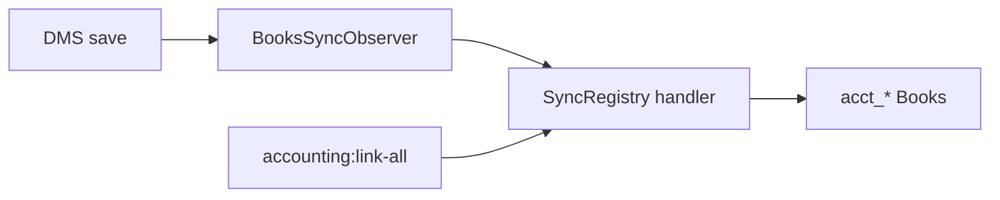

# DMS & Books features — sync status map

Company link is via `accounting_company_links` (Avit Digital DMS ↔ Books). Entity links live in `sync_entity_links`. Live saves use `BooksSyncObserver`; one-shot push uses `php artisan accounting:link-all` / `accounting:backfill`.



---

## Sync legend

| Status | Meaning |
|--------|---------|
| **Auto** | Observer on save/update/delete → pushes (or re-pushes related docs) |
| **Reuse UI** | Books sidebar opens the DMS screen |
| **Books-only** | Exists only in Accounting Books; no DMS mirror |
| **No sync** | No Books document target (report UI or pure commercial/HR ops) |

---

## Synced (Auto)

| Feature | Books target |
|---------|--------------|
| Company bank | Bank account |
| Branches | Books Branch (+ link map) |
| Financial Years | Books FY (+ link map) |
| Sister Concerns | ConsolidationMap (when ≥2 companies provisioned) |
| Brands / Categories / Sub Categories | Product Groups |
| Products / UOMs / Parties | Product / Unit / Party |
| Price List (CustomerType + PriceMaster) | PriceList + lines (+ PartyPriceList) |
| Warehouses | Godown |
| Stock levels → opening | Stock In receipt |
| Stock Transfer / Adjustments / Movements | Stock Transfer / Journal / In-Out |
| Serial Numbers | StockSerial |
| Stock Valuation **setting** | Company.inventory_valuation_method |
| Quotations / Orders / Tax Invoices / Credit Notes | Quotation / SO / SI / CN |
| Purchase Orders / Inwards / Invoices | PO / GRN / PI |
| Freight Bills / Landed Cost | LandedCostVoucher |
| Payment Receipts / Cheques | Receipt/Payment vouchers |
| Outstanding ledger **rows** | Re-pushes source invoice/payment/CN |
| Trip Sheets / Deliveries / Settlements | Re-pushes linked invoices |
| OD accounts / Bank txs | Bank Account / journals |
| Employees (HRMS) | Books Employee |
| Expense Types | Expense ledgers |
| CRM Leads | Books Party (or Customer when converted) |

---

## Not synced

| Feature | Why |
|---------|-----|
| Region Policies | Sales rules only — no Books model |
| Commercials: Deals, Targets, Schemes, Interest | Analytical engines — no Books docs (Expense Types **are** Auto) |
| Leave / Attendance / HR Claims | Parallel HR ops — not Books payroll docs |
| Lead Segments | CRM taxonomy — no Books model |
| Stock Valuation / Aging / Reconciliation / DMS P&L·BS·TB reports | Computed report UIs (data comes from synced docs) |
| Books-only: PR, RFQ, Debit Notes, Payment batches, Prepaid/Accrued, GST returns UI, Fixed Assets, Payroll runs, KPIs | No DMS source documents |

---

## Compact checklist

**Auto:** Company bank, Branches, FYs, Sister Concerns, Brands, Categories, Sub Categories, Products, UOMs, Parties, Price lists, Warehouses, Quotations, Orders, Invoices, CNs, POs, Inwards, Freight, Landed Cost, Payments, Cheques, Stock (levels/opening/transfers/adjustments/movements/serials), Valuation setting, Load sheets, Deliveries, Settlements, Outstanding rows (via source docs), OD + bank txs, Employees, Expense Types, Leads

**No sync / Books-only / reports:** Region Policies; Deals/Targets/Schemes/Interest; Leave/Attendance/Claims; Lead Segments; all report screens; Books-native PR/RFQ/DN/batches/prepaid/accrued/GST UI/FA/Payroll/KPIs

---

## Refresh

```bash
php artisan accounting:link-all
```

**Core:** `SyncRegistry.php` · `AppServiceProvider.php` · `config/books_sidebar.php` · `resources/views/partials/sidebar.blade.php`
